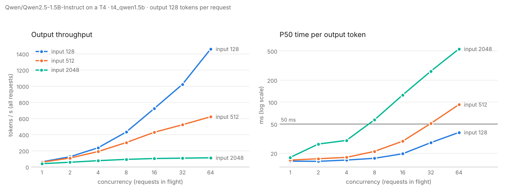
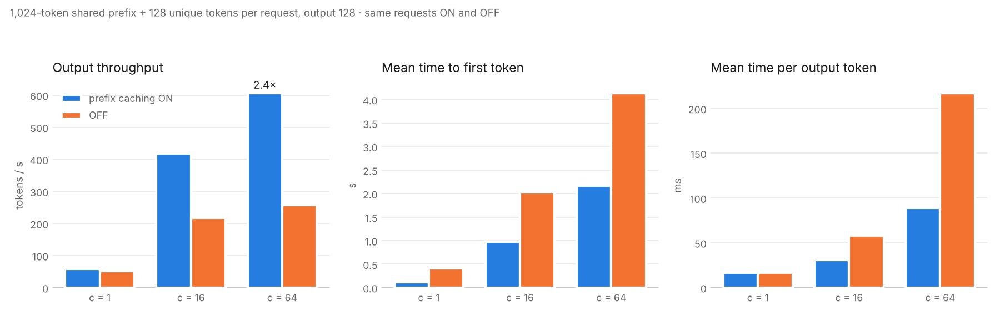

# vllm-serving-bench

How do batch size and context length affect LLM serving performance?
This project serves a small model with [vLLM](https://docs.vllm.ai/), sends it many requests at once, and measures **throughput** and **p50/p99 latency** while changing two things:

- **Concurrency** (how many requests are in flight at the same time ≈ batch size): 1 → 64
- **Context length** (prompt length in tokens): 128, 512, 2048

It also measures **prefix caching** ON vs OFF, and includes a [KV cache built from scratch](#kv-cache-from-scratch) to see the mechanism underneath.

## Key findings

All runs: Qwen2.5-1.5B-Instruct (FP16) on a free Colab T4, 128 output tokens per request.

- **Short prompts: batching is nearly free.** Input 128, concurrency 1 → 64: output throughput **63 → 1,459 tok/s (23×)**, while P50 time per output token only goes 15.6 → 38.5 ms. Decode is memory-bound, so extra requests share each weight read.
- **Long prompts: prefill becomes the bottleneck.** Input 2048: throughput levels off at **~110 tok/s** from concurrency 16 on, while P50 TPOT grows to 534 ms. Prefill runs at ~2,200 tok/s on the T4, which caps output at ≈ 2,200 × 128 / 2048 ≈ 137 tok/s.
- **Capacity at P99 TPOT < 50 ms:** 64 / 16 / 4 concurrent requests for input 128 / 512 / 2048.
- **Prefix caching pays off under load.** With a 1,024-token shared prefix: **2.4× throughput** and **−47% mean TTFT** at concurrency 64, but only +12% throughput at concurrency 1.
- **KV cache from scratch:** matches a full recompute (max |Δ logit| 5.3e-7), but gives no speedup for a 10.8M-parameter model on the T4: per-token time is dominated by kernel-launch overhead, not compute.

## Questions

1. How much does throughput grow as concurrency increases, and where does it stop growing?
2. How much slower does each user's generation get (TPOT) as the batch grows?
3. When does time to first token (TTFT) jump because requests start waiting in a queue?
4. How does a longer context change all of the above? (Longer prompts → bigger KV cache per request → fewer requests fit in GPU memory.)

**Expectation (from ORCA and vLLM):** decode is memory-bound, so batching should raise throughput almost for free, until compute or KV-cache memory runs out.

## Metrics

| Metric | Meaning |
|---|---|
| Output throughput | Generated tokens per second, summed over all requests |
| TTFT | Time to first token: how long a user waits before the answer starts |
| TPOT | Time per output token after the first one: how fast the answer streams |
| E2E latency | Total time for one request, start to finish |
| p50 / p99 | Median / 99th percentile: the typical request vs. the slowest 1% |

## Environment

| Item | Value |
|---|---|
| GPU | Tesla T4 on Google Colab (14.56 GiB usable) |
| vLLM version | 0.34.0 (Colab Python 3.13) |
| Model | Qwen/Qwen2.5-1.5B-Instruct (float16) |
| Server flags | `--dtype half --max-model-len 4096 --gpu-memory-utilization 0.90` |
| KV cache capacity (tokens) | 335,872 (5,248 blocks × 64 tokens, 8.97 GiB) |
| Attention | FlashAttention 2 unavailable on T4 (compute capability 7.5); vLLM falls back to another backend |

## How to run

| Notebook | What it runs |
|---|---|
| [`colab_vllm_t4gpu.ipynb`](colab_vllm_t4gpu.ipynb) | vLLM: server setup, the sweep (`sweep.sh`), prefix caching ON/OFF |
| [`colab_sglang.ipynb`](colab_sglang.ipynb) | SGLang: the same experiments, measured with the same vLLM benchmark client (**not run yet**) |
| [`kv-cache-from-scratch/kv_cache_from_scratch.ipynb`](kv-cache-from-scratch/kv_cache_from_scratch.ipynb) | KV cache added to Karpathy's GPT: correctness test + benchmark |

Open a notebook in Colab (**File → Open notebook → GitHub**), pick a T4 runtime, and run the cells top to bottom.
`sweep.sh` can also be run on any machine with a server already running; see the comments at the top of the script.
To redraw the figures and print the tables below: `python plot.py --table` (needs only matplotlib).

## Results

### 1. Concurrency × context length

`sweep.sh`: 21 runs (concurrency {1, 2, 4, 8, 16, 32, 64} × input {128, 512, 2048}), at least 32 requests per run (5 per concurrency slot), a new random seed per run so no request hits the prefix cache. Raw results: [`results/t4_qwen1.5b/`](results/t4_qwen1.5b/).



**Output throughput (tok/s)**

| Input | c=1 | c=2 | c=4 | c=8 | c=16 | c=32 | c=64 |
|---|---|---|---|---|---|---|---|
| 128 | 63 | 126 | 237 | 432 | 724 | 1023 | 1459 |
| 512 | 59 | 110 | 191 | 302 | 429 | 522 | 621 |
| 2048 | 40 | 58 | 78 | 94 | 104 | 109 | 113 |

**P50 TPOT (ms)**

| Input | c=1 | c=2 | c=4 | c=8 | c=16 | c=32 | c=64 |
|---|---|---|---|---|---|---|---|
| 128 | 15.6 | 15.5 | 16.1 | 17.0 | 19.7 | 27.9 | 38.5 |
| 512 | 16.1 | 16.8 | 17.5 | 21.2 | 29.2 | 51.1 | 92.6 |
| 2048 | 17.5 | 26.7 | 30.0 | 57.3 | 125.3 | 265.0 | 533.8 |

**P99 TTFT (ms)**

| Input | c=1 | c=2 | c=4 | c=8 | c=16 | c=32 | c=64 |
|---|---|---|---|---|---|---|---|
| 128 | 53 | 94 | 169 | 255 | 411 | 715 | 1,392 |
| 512 | 192 | 314 | 582 | 997 | 1,856 | 3,552 | 6,983 |
| 2048 | 1,012 | 1,956 | 3,763 | 7,374 | 14,676 | 29,417 | 58,984 |

**What it shows**

| Input | Bottleneck |
|---|---|
| 128 | Memory bandwidth: batching is nearly free (23× throughput from c=1 to c=64) |
| 512 | Flattens after c=16; P99 inter-token latency jumps to 333 ms there, as prefills start stalling decode steps |
| 2048 | **Prefill compute**: capped near 2,200 × 128 / 2048 ≈ 137 tok/s |

- P99 TTFT at input 2048 (15 s / 29 s / 59 s at c = 16 / 32 / 64) is mostly the **start-up burst**: all requests arrive at once and their prefills queue (64 × 2048 / ~2,200 tok/s ≈ 60 s).
- Capacity at **P99 TPOT < 50 ms**: input 128 → 64 users, 512 → 16, 2048 → 4.
- The KV cache never fills: a 2048 + 128-token request needs 34 blocks, so ~154 fit at once, more than the maximum concurrency of 64.

### 2. Prefix caching ON vs OFF

Every request = a **1,024-token shared prefix** (like a long system prompt) + 128 unique tokens, 128 output tokens. The ON and OFF runs use the same seeds, so they send identical requests. Raw results: [`results/t4_prefix_on/`](results/t4_prefix_on/), [`results/t4_prefix_off/`](results/t4_prefix_off/).



| Concurrency | Throughput ON / OFF (tok/s) | Mean TTFT ON / OFF (ms) | Mean TPOT ON / OFF (ms) |
|---|---|---|---|
| 1 | 58 / 52 (1.12×) | 113 / 407 | 16.5 / 16.4 |
| 16 | 417 / 217 (1.92×) | 976 / 2,029 | 30.9 / 58.0 |
| 64 | 606 / 257 (2.36×) | 2,173 / 4,135 | 89.1 / 217.0 |

Prefix caching skips ~89% of each request's prefill (only 128 of 1,152 tokens are new). At concurrency 1 most of the time is decode, so the gain is small; under load the system is prefill-bound, so **the busier the server, the bigger the win**. TPOT also improves, because fewer prefill chunks stall the decode steps.

### 3. SGLang

The notebook is ready ([`colab_sglang.ipynb`](colab_sglang.ipynb)): same sweep, same prefix-caching test (radix cache ON/OFF), same client and seeds. Results pending.

## KV cache from scratch

[`kv-cache-from-scratch/`](kv-cache-from-scratch/) adds a KV cache to the character-level GPT from Karpathy's [Let's build GPT](https://www.youtube.com/watch?v=kCc8FmEb1nY) (10.8M parameters, 6 layers × 6 heads): prefill/decode split, a per-head cache, the causal mask offset (the T new queries are the *last* T rows), and the position offset (`start_pos`).

| | Result |
|---|---|
| Correctness | Prefill + decode logits match a full recompute: max abs diff **5.3e-7** (FP32 rounding) |
| Throughput (T4, 25–150 tokens) | No cache ≈ **59 tok/s** at every length; KV cache 0.68–0.96× of that: **no speedup** |

The no-cache path recomputes the whole sequence, so its work grows with length, yet its per-token latency stays at ≈ 17 ms: the bottleneck is not compute but the hundreds of tiny kernel launches per token (one set per head per layer). A KV cache saves FLOPs, so it only pays off when FLOPs are the bottleneck, as in the vLLM runs above.

The throughput numbers come from the first run, before a one-line fix in `generate_cached` (the prefill ran without the cache); re-running the notebook refreshes them.

## Repo layout

```
colab_vllm_t4gpu.ipynb   # vLLM: server setup, sweep, prefix caching ON/OFF (with outputs)
colab_sglang.ipynb       # SGLang: the same experiments with the same client (not run yet)
sweep.sh                 # concurrency × input-length sweep against a running server
plot.py                  # results/*.json → plots/*.png; --table prints the tables above
results/                 # raw benchmark results (JSON), one folder per setup
plots/                   # figures used in this README
kv-cache-from-scratch/   # KV cache added to Karpathy's GPT: correctness test + benchmark
```
